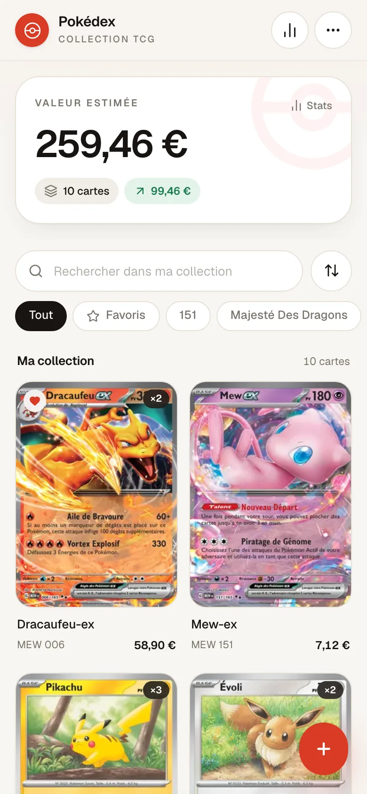

# Pokédex TCG

Suivez votre collection de cartes Pokémon dans un Pokédex personnel, simple et pensé mobile d'abord.

**Démo : [pokedex-gules-mu-76.vercel.app](https://pokedex-gules-mu-76.vercel.app)**

<p align="center">
  
</p>

## Fonctionnalités

- Recherche dans le catalogue francophone (noms FR) et ajout en un geste
- Prix Cardmarket en euros, actualisation par carte ou pour toute la collection
- Scans officiels, ou photo personnelle compressée directement dans l'app
- Code de série, numéro, rareté, type, état, langue et quantité
- Valeur totale, prix d'achat, investissement et plus-value
- Statistiques par série et par état
- Favoris, filtres par série, recherche locale et tri
- Export / import JSON pour sauvegarder ou changer d'appareil
- Ajout à l'écran d'accueil (manifest, icônes), thème clair/sombre automatique

## Stack

- [Next.js 16](https://nextjs.org) (App Router) + React 19
- [Tailwind CSS 4](https://tailwindcss.com)
- [lucide-react](https://lucide.dev)
- [TCGdex API](https://tcgdex.dev) pour les cartes, les scans et les prix Cardmarket
- Images de secours TCGplayer pour les cartes sans scan TCGdex

## Démarrage

```bash
npm install
npm run dev
```

Ouvrir [http://localhost:3000](http://localhost:3000).

```bash
npm run build   # build de production
npm run lint    # ESLint
```

## Données et prix

Votre collection est stockée **uniquement dans le `localStorage` de votre navigateur**.
Aucun compte, aucune base de données, aucun envoi de votre collection.

- Les prix proviennent de Cardmarket via TCGdex et restent indicatifs.
- Ils sont actualisés manuellement depuis le menu « Réglages ».
- Pensez à exporter une sauvegarde JSON avant de vider votre navigateur ou de changer d'appareil.

## Déploiement

Le projet est hébergé sur Vercel et chaque push sur `main` redéploie la production.

```bash
npx vercel --prod
```

## Crédits

Données et visuels de cartes : [TCGdex](https://tcgdex.dev), TCGplayer et Cardmarket.
Projet non officiel, non affilié à Nintendo, Creatures Inc. ou The Pokémon Company.
